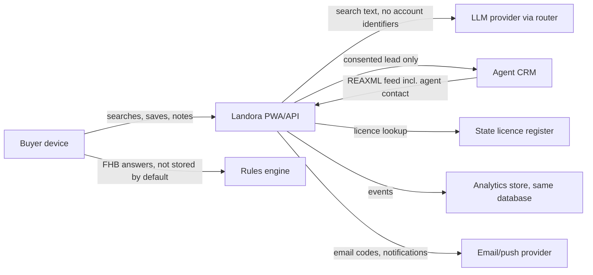

# Privacy impact assessment: draft

Status: **Draft 0.1, written for the design semester, 2026-10-28.** This is not legal advice. V11 §12.5 requires a completed PIA before pilot, reviewed by a qualified privacy adviser. This draft structures that work and records the design decisions already taken. It follows the OAIC *Guide to undertaking privacy impact assessments*.

Companion: [data-inventory.md](data-inventory.md), which lists purpose, source, retention, access and disclosure for every personal data item.

## 1. Project description

Landora is a buyer-first property search PWA for an initial pilot in Queensland (Sunshine Coast suburbs). Buyers search, save, share and plan inspections. Licensed agents publish listings through REAXML feeds. Platform staff verify agents and moderate content. An AI concierge interprets searches and answers questions from approved sources (V11 §12.6).

People whose information is handled:

- Buyers and renters, including first home buyers.
- Agents and agency administrators.
- Moderators and platform administrators.
- Vendors and other people named in listing content. This is incidental; listing text can contain names.

## 2. Is Landora covered by the Privacy Act?

**Recommendation: operate as an APP entity from day one, whatever the turnover.**

- **Why:** The small business exemption (annual turnover of $3m or less) does not apply to a business that discloses personal information to anyone else for a benefit, service or advantage. Sharing buyer leads with agents (FR-LEAD-001, FR-AGT-004) is likely to fall in that category even with consent. Investors and agency partners will also expect APP compliance.
- **Risk if not:** Retrofitting consent and records later is expensive, and lead-sharing could be unlawful without it.
- **Alternative:** Rely on the exemption until revenue reaches $3m and never share leads. That isn't viable, because lead-sharing is in MVP scope.
- **MVP impact:** No new features. It formalises the controls already in the backlog.
- **To confirm:** Adviser to confirm the "trading in personal information" analysis.

## 3. Information flows

## 4. Analysis against the Australian Privacy Principles

| APP | Issue for Landora | Design response | Status |
| --- | --- | --- | --- |
| 1 Open and transparent management | A privacy policy is needed. From **10 Dec 2026**, it must describe any automated decisions that significantly affect individuals (APP 1.7–1.9). | Publish a policy before pilot. The FHB check, agent verification and the publication gate are automated. Treat agent verification and publication blocking as covered, because they affect agents' commercial interests. Name them in the policy and offer human review. | To do (pre-pilot) |
| 3 Collection | Collect only what's needed | Search works without an account. Saves stay on the device until sign-in. The FHB check asks no income question and doesn't store answers. | Built in prototype |
| 5 Notification | Collection notices at each point | Short notices at sign-up, the FHB check, concierge opt-in and lead consent. | Copy drafted in prototype for FHB; others to do |
| 6 Use and disclosure | Leads to agents; LLM provider; analytics | Leads only with purpose-specific consent recorded (`lead_consent_granted`). The LLM receives search text without account identifiers. Analytics is used for product KPIs only. | Designed; not built |
| 7 Direct marketing | Marketing emails | Separate opt-in, off by default, unsubscribe in every message. | To do |
| 8 Cross-border disclosure | LLM and email providers may process data outside Australia | Prefer Australian-region processing (ADR 0010 for hosting). For the LLM, use a provider and region with no-training and short-retention terms. Record each recipient's country in the data inventory. | Open: depends on LLM provider choice |
| 10 Quality | Listing data accuracy | Feed provenance on every field; conflicts flagged rather than overwritten (V11 §12.7). | Built (schema) |
| 11 Security | Breach risk; retention | Encryption in transit and at rest (NFR-SEC-001), MFA for admins, least privilege, retention schedule below, deletion jobs. | Designed |
| 12, 13 Access and correction | Buyers can see and fix their data | Account page export (JSON) and delete. Agents correct listing data through the feed or console. | To do |

## 5. Key risks and recommendations

| # | Risk | Likelihood / impact | Recommendation | Backlog link |
| - | --- | --- | --- | --- |
| R1 | Buyer details reach agents without valid consent, for example through an intent threshold | Medium / High | Server-side rule: `lead_sent` requires a prior, unexpired `lead_consent_granted` for that agent and listing. No automated disclosure. Test in CI. | FR-LEAD-001, FR-AGT-004 |
| R2 | First home buyer financial answers are stored or reused | Low / High | Default to no storage (as built). If "save my answers" is added, use separate consent, a 12-month retention limit, and never use the answers for marketing or monetisation (V11 §12.5). | FR-FHB-001 |
| R3 | Search text sent to the LLM contains personal details ("I'm pregnant, need 3 bed…") | Medium / Medium | Strip emails and phone numbers before sending. Choose a provider contract with no training and short retention. Disclose the use in the policy. | FR-AI-003 |
| R4 | Concierge memory builds a profile the buyer didn't expect | Medium / Medium | Off by default. The buyer sees and deletes what is remembered. Store only from an allow-list. | FR-AI-004 |
| R5 | Append-only audit log keeps personal data after account deletion | High / Low | Store IDs in audit `before`/`after`, not names or emails. On deletion, the user's audit rows keep the UUID only. Document this as a lawful retention exception. | FR-ADM-002 |
| R6 | Analytics re-identifies anonymous visitors | Low / Medium | Random per-device ID only. No fingerprinting. `user_id` is set to null on account deletion (already in migration 0002). | FR-ANL-001 |
| R7 | Agent licence data held beyond need | Low / Low | Keep verification status and source. Recheck on schedule. Delete agent personal data 2 years after the account closes, unless it is needed for an audit. | FR-AGT-001 |
| R8 | Listing text and photos contain vendor or tenant personal information (names, family photos) | Medium / Medium | Agent terms require consent for published content. Moderation can remove it. Listing data is removed from search when the listing is withdrawn. | FR-ADM-001 |
| R9 | Children's data (Children's Online Privacy Code, exposure draft 2026) | Low / Medium | Landora is not directed at children. Require a declared age of 18+ at sign-up. Track the final code. | FR-ACC-001 |

## 6. Consent purposes (V11 §12.5)

Each purpose is separate, optional unless stated, recorded with time and version, and revocable.

| Purpose | Default | Needed for | Event |
| --- | --- | --- | --- |
| Essential service (account, saved homes) | Required to have an account | FR-ACC-001, FR-SAVE-001 | none |
| Product analytics | On, with an opt-out. Confirm against the policy; the alternative is consent-first. | FR-ANL-001 KPIs | none |
| Concierge memory | Off | FR-AI-004 | consent record |
| Marketing | Off | Email campaigns | consent record |
| Share my details with this agent | Off, asked per listing | FR-LEAD-001 | `lead_consent_requested`, `lead_consent_granted` |
| Save my first home answers | Off (not built) | Future FHB continuity | consent record |

**Decision needed (PO):** Is product analytics on with an opt-out, or off until consent? On with an opt-out gives complete KPIs. Consent-first is more conservative and lowers the measured weekly active buyers. Recommendation: on with an opt-out, limited to first-party product analytics with no advertising use, disclosed in the policy.

## 7. Incident and correction workflows (to finish before production)

- **Privacy incident:** Contain the breach and assess it within 30 days under the Notifiable Data Breaches scheme. Notify the OAIC and affected people if serious harm is likely. The runbook owner is the Engineering Lead.
- **Data correction:** Buyers fix their own account data. Listing errors go to the agent through the console, and admins can unpublish in the meantime.
- **Access request:** Respond within 30 days with a JSON export.

## 8. Before pilot

- [ ] Privacy adviser reviews this PIA and confirms §2.
- [ ] LLM, email and hosting providers chosen, with data processing terms and regions recorded.
- [ ] Privacy policy and collection notices published, including the automated decision disclosures (APP 1.7–1.9).
- [ ] Consent records, export and deletion implemented and tested.
- [ ] Retention jobs implemented for each row of the data inventory.
- [ ] Incident runbook tested in a tabletop exercise.

Sources checked on 2026-10-28: [OAIC consultation on automated decision-making transparency](https://www.oaic.gov.au/engage-with-us/consultations/consultation-on-guidance-for-transparency-in-automated-decision-making); [Allens: APP 1 automated decision amendments commence 10 December 2026](https://www.allens.com.au/insights-news/insights/2026/06/automated-decision-making-transparency-what-app-entities-need-to-know-about-the-app-1-amendments/).
