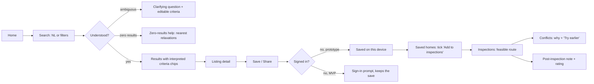
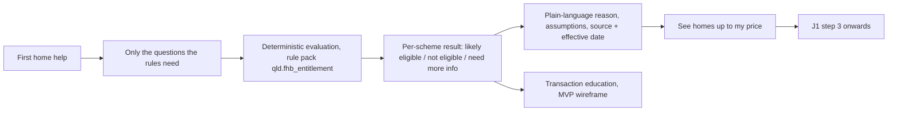
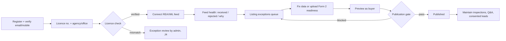

# Canonical MVP journeys J1–J4: UX flows

Status: draft for Product Owner approval (V11 §14.3 exit: "Wireframes/UX flows approved for the J1–J4 canonical journeys").
Source: V11 §12.2 (journeys), §12.3 (functional requirements), §12.8 (analytics events).
Date: 2026-10-28.

How to read this:

- Each step lists the screen, the requirement it serves (with priority), the states the screen must handle, and the analytics event it fires.
- **Prototype** marks what you can click through today in `apps/web` on synthetic data. **Wireframe** marks screens that exist here only as low-fi layouts.
- Every screen must handle loading, empty and error states, be keyboard and screen-reader usable, and work at 360 px wide first.

## Cross-cutting rules for every journey

| Rule | Where it shows up |
| --- | --- |
| AI never invents property, price, zoning or compliance facts (FR-AI-002, P0) | Search shows "How we read your search" with every assumption. Unsupported asks such as "good investment" are named as unsupported, not answered. |
| No legal or financial advice | The footer on every page, the FHB result disclaimer and the disclosure panel wording ("confirms the documents are ready, not what they say") |
| Sources and dates on every fact | Listing facts cite the feed and its update time. Rule results cite the pack version, effective date and official source. |
| Only compliant listings are visible (FR-CMP-002, P0) | QLD listings without Form 2 readiness or a verified agent are never published. This was decided on 2026-10-28 ("Block until ready", as in V11). |
| Minimum data (V11 §12.5) | The FHB check does not store answers and does not ask about income. Shortlist and notes stay on the device until sign-in (FR-ACC-001). |
| Each role sees only its own tools (FR-ACC-002, P0) | Navigation is per role. Opening another role's page shows "Access denied"; a guest is asked to sign in instead. The server checks every page and action. |

## Roles and the prototype "Viewing as" menu

The prototype has no real sign-in yet. A **Viewing as** menu in the header (marked "Prototype") switches between a guest and the five V11 roles. The choice is kept on the device. This is recorded in [ADR 0011](../adr/0011-mock-role-switcher-before-real-auth.md), accepted by the project lead on 2026-10-28 and awaiting PO approval.

| Role | Who you are in the prototype | Navigation | Can | Priority |
| --- | --- | --- | --- | --- |
| Guest | Signed out | Search, Saved, Inspections, First home | Browse, search, FHB check, share a listing link. Save and inspections ask you to sign in (the "Sign in" button switches to Buyer). | P0 (FR-ACC-001) |
| Buyer | Sample Buyer (prototype persona) | Search, Saved, Inspections, First home, Account | Save, share, plan inspections, `/account` (saved count, consent, delete my data) | P0 (FR-ACC-001/002); saving and sharing are P1 (FR-SAVE-001, FR-SHARE-001) |
| Agent | Casey Mockley, Synthetic Coast Realty (dataset) | Search, Agent console | `/agent`: licence status, feed runs, own listings, preview, publish/unpublish when the gate passes | P0 (FR-AGT-001..003) |
| Agency admin | Riley Placeholder, same agency (dataset) | Search, Agency console | Everything an agent can do, for every listing in the agency, plus the agency's agents and their verification | P0 (FR-ACC-002, FR-AGT-002) |
| Moderator | Sample Moderator (prototype persona) | Search, Admin | `/admin` read-only, moderation queue, audit log | P0 (FR-ADM-001); the queue's content (Q&A) is P1 |
| Platform admin | Sample Platform Admin (prototype persona) | Search, Admin | Everything a moderator can do, plus role changes and verification decisions, each with a mandatory reason | P0 (FR-ADM-001/002) |

The buyer account page has no public profile, because profiles are FR-SOC-001 (P1, MVP-2). Its consent toggles cover the three purposes the prototype can act on (analytics, concierge memory, sharing with agents). V11 §12.5 also names marketing and financial/readiness sharing; they get toggles when a feature uses them. Turning analytics off stops the prototype sending events.

---

---

## J1: Buyer discovery to inspection



| # | Step (V11) | Screen | Requirement | States to handle | Event | Status |
| - | --- | --- | --- | --- | --- | --- |
| 1 | Discover Landora | `/` home with search box and example searches | — | First visit, returning (shortlist badge) | — | Prototype |
| 2 | NL search or filters | `/search?q=` and the Criteria panel | FR-SRCH-001/002 P0 | Loading skeleton, invalid params (ignored safely) | `search_started`, `search_completed` | Prototype (rule-based parser stands in for the LLM router, ADR 0006) |
| 3 | Review interpreted criteria, results, citations | "How we read your search" card plus chips | FR-SRCH-003 P0, FR-AI-002 P0 | Ambiguous (clarification), unsupported ask, zero results, hidden-price note | `search_zero_results` | Prototype |
| 4 | Listing: property, suburb, inspections, compliance | `/listing/[id]` | FR-LST-001/002/003 P0 | Not found / withdrawn (404 page), placeholder valuation flagged, disclosure panel | `listing_viewed` | Prototype |
| 5 | Save/share; sign in when persistence needed | Save and Share buttons | FR-SAVE-001 P1, FR-SHARE-001 P1, FR-ACC-001 P0 | Storage blocked ("Couldn't save on this device"), Web Share unavailable (copy-link fallback) | `listing_saved`, `listing_unsaved`, `listing_shared` | Prototype on device; sign-in is a wireframe |
| 6 | Build shortlist and timeline | `/shortlist` | FR-INSP-001 P1 | Empty shortlist, listing since withdrawn ("no longer available"), no open homes | `inspection_added` | Prototype |
| 7 | Feasible sequence with buffers and conflicts | `/inspections` (old `/timeline` redirects) | FR-INSP-002/003 P1 | Empty plan, no upcoming opens, conflicts, manual reorder, multiple days | `inspection_route_created`, `inspection_conflict_detected` | Prototype (straight-line estimate; routing API is a later ADR) |
| 8 | Post-inspection notes and rating | Note editor inside each stop | FR-INSP-003 P1 | Save failed, 2,000-character cap | `inspection_note_added` | Prototype |

Low-fi wireframe of the search results screen at mobile width:

```
┌──────────────────────────────┐
│ Prototype banner (synthetic) │
│ Landora  Search Saved Plan 1st home │
├──────────────────────────────┤
│ [ 3 bed house in Buderim… ]  │
│ [        Search          ]   │
│ ┌ How we read your search ─┐ │
│ │ (In Buderim) (house)     │ │
│ │ (3+ bed) (up to $900k)   │ │
│ │ Assumption: "3 bed" = ≥3 │ │
│ │ Not supported: "good     │ │
│ │ investment". We can't    │ │
│ │ judge that.              │ │
│ └──────────────────────────┘ │
│ ▸ Criteria (edit filters)    │
│ 12 homes  [chips…]           │
│ ┌ photo ───────────────────┐ │
│ │ $850,000          [♡]    │ │
│ │ 178 Template Tce…        │ │
│ │ 5 bed · 3 bath · 1 car   │ │
│ │ ✓ Disclosure-ready  Open Sat 11:00 │
│ └──────────────────────────┘ │
└──────────────────────────────┘
```

---

## J2: First-home buyer guidance



| # | Step (V11) | Screen | Requirement | States | Event | Status |
| - | --- | --- | --- | --- | --- | --- |
| 1 | Enter concierge, give only required info | `/first-home` form | FR-FHB-001 P1, §12.5 | Every question optional, "Not sure" allowed, invalid price/deposit | none (see gap 1) | Prototype |
| 2 | Deterministic results with source and date | Results list | FR-FHB-001/002 P1 | Needs more info (lists what's missing), rule-pack load failure, draft-pack banner | — | Prototype |
| 3 | Plain-language explanation and eligible-property filters | Result card, "See homes up to $X" | FR-FHB-002 P1 | Zero matching homes falls back to J1 zero-results | — | Prototype (price filter only; "new homes only" filter is next) |
| 4 | Continue to search, shortlist, plan | Links into J1 | — | — | — | Prototype |
| 5 | Transaction education, no personal advice | Static guides: contract, cooling-off, Form 2, conveyancer | §5.8 | — | — | Wireframe |

Low-fi wireframe of a result card:

```
┌ Federal First Home Guarantee ── [Likely eligible] ┐
│ Guarantee of up to 15% so you can buy with 5%     │
│ deposit. Places unlimited from 1 Oct 2025.        │
│ ▸ Assumptions and limits                          │
│ Source: Housing Australia (checked 28 Oct 2026)   │
└───────────────────────────────────────────────────┘
DRAFT. General information only, not financial or legal advice.
Rules version 0.1.0 (draft), in effect from 1 Oct 2025.
[ See homes up to $720,000 ]
```

---

## J3: Agent onboarding to publication

**Prototype** for steps 3 and 5 to 7 at `/agent` (Viewing as Agent or Agency admin). It reads the synthetic dataset, the QLD publication rule pack and the sample REAXML runs, parsed by the real adapter in `packages/ingest`. Steps 1, 2, 4 and 8 remain **wireframes**.



| # | Step | Screen | Requirement | States | Events |
| - | --- | --- | --- | --- | --- |
| 1 | Register, verify contact | Sign-up, code entry | FR-ACC-001 P0 | Code expired, already registered | — |
| 2 | Licence and agency | Licence form | FR-AGT-001 P0 | Agency not found ("request add") | `agent_verification_started` |
| 3 | Verification or exception | **Prototype:** licence card on the console | FR-AGT-001 P0 | Pending (expected time), verified, exception raised | `agent_verified`, `agent_verification_exception` |
| 4 | Connect feed | Feed setup: provider, agency ID, test file upload | FR-FEED-001 P0 | Invalid XML (line-level message), wrong agency ID | `feed_record_received` |
| 5 | Feed health | **Prototype:** last run, counts, rejected records with reasons, malformed-file message | FR-AGT-002 P0, FR-FEED-002 P0 | No runs yet, stale feed (>24 h) | `feed_record_rejected` |
| 6 | Resolve exceptions | **Prototype:** listings filtered to "Needs action", each failing rule with the pack's fix text (for example the Form 2 block) | FR-CMP-001/002 P0 | Blocking vs incomplete vs warning | `compliance_check_failed` |
| 7 | Preview and publish | **Prototype:** preview renders the buyer listing component; Publish disabled until the gate passes; Unpublish removes the listing from search | FR-AGT-003 P0 | Gate failure explains which rule and how to fix | `compliance_check_passed`, `listing_published` |
| 8 | Maintain, Q&A, leads | Listing manager, Q&A inbox, leads with consent record | FR-AGT-004 P1, FR-QA-001 P1, FR-LEAD-001 P1 | No questions, lead without consent never shown | `agent_question_answered`, `lead_sent` |

```
┌ Listing exceptions (3) ──────────────────────────┐
│ 12 Sample St, Buderim     [Blocked]              │
│  ✗ Form 2 seller disclosure statement ready      │
│    Upload confirmation or mark as ready →        │
│  ✓ Listing agent is licence-verified             │
│  ? Pool safety certificate: not in feed          │
│ [Preview as buyer]  [Publish] (disabled)         │
└──────────────────────────────────────────────────┘
```

---

## J4: Platform administration

**Prototype** at `/admin` for steps 1, 2 (without Reprocess), 4 and 5 (audit trail only). Moderator and platform admin share the console; only the platform admin can change roles or decide verification. Steps 3 and 6 remain **wireframes**.

| # | Step | Screen | Requirement | Key states | Events |
| - | --- | --- | --- | --- | --- |
| 1 | Review users, agents, agencies, exceptions, listings | Admin home with queues and counts | FR-ADM-001 P0 | Empty queues, overdue items (SLA) | — |
| 2 | Monitor and reprocess REAXML failures | Feed runs, raw record viewer, Reprocess | FR-FEED-002 P0 | Idempotent replay (same modTime is a no-op) | `feed_record_rejected` |
| 3 | Compliance exceptions and rule config | Exception queue; rule packs list with version, status, diff; activate draft (two-person) | FR-CMP-003 P0, FR-ADM-002 P0 | Draft vs active pack, rollback | `listing_unpublished` |
| 4 | Moderate Q&A and seeded content | Moderation queue | FR-QA-001 P1 | Reported content, appeal | — |
| 5 | AI/data incidents, audit, metrics | Incident log, audit trail, KPI views from migration 0002 | FR-AI-002 P0, FR-ANL-001 P0 | Incident severity, export | `concierge_failure` |
| 6 | Feature flags and config | Flags per environment | FR-ADM-001 P0 | Change requires reason; audited | — |

Privileged actions (activate rule pack, override verification, unpublish) require a reason and are audit-logged (FR-ADM-002). Rule-pack activation needs a second approver.

In the prototype the audit log records publish, unpublish, role changes, verification decisions and refused attempts, with actor, role, target, before and after, reason and time. It is read-only and kept in server memory, so it clears on restart. Queue cards show counts and the oldest feed failure's age; the synthetic data has no submission dates for verification, and SLA targets are not yet set (NFR-AVL-001).

---

## Gaps and conflicts found while mapping

1. **No FHB events in §12.8.** J2 can't be measured as specified. Recommendation: add `fhb_check_completed` with only `{packVersion, resultCounts}` and no answers. This is a PO decision because it changes the event catalogue. P1.
2. **Sign-in timing.** V11 J1.5 says "sign in when persistence is required", and FR-SAVE-001 says "authenticated buyers". The prototype now asks guests to sign in before saving or planning inspections (decided 2026-10-28, ADR 0011), which supersedes the earlier "device saves without an account" recommendation. Sharing a public listing link stays open to guests as a growth loop. P0 for MVP (FR-ACC-001).
3. **Routing accuracy.** The plan uses a straight-line estimate. A routing provider needs its own ADR on cost and terms. P1.
4. **Form 2 timing.** As flagged in step 2, the law requires Form 2 before contract, not before marketing. Our gate is stricter by policy (decided 2026-10-28).
5. **No consent records in the schema.** §12.5 needs purpose-specific consent with who, what, when and purpose (FR-AGT-004), but migration 0001 has no consent table. The prototype keeps choices on the device. Recommendation: add a `consent_event` table before the build semester. P0 for MVP.
6. **Moderation has nothing to moderate in MVP-0.** FR-ADM-001 (P0) asks for moderation, but the content it moderates (Q&A, FR-QA-001) is P1. The prototype shows an empty queue rather than invented content. P0 console, P1 content.

## Prototype screenshots

`docs/ux/screens/` contains mobile (390 px) and desktop (1280 px) captures of every prototype screen, produced by an automated walkthrough that also checks for console errors and horizontal overflow. Captures are full page except 21, which shows only the listing's questions section. The last run on 2026-10-29 (after the theme pass, listing photos and the social hub preview) found no issues.

Screens 19–28 are the social hub preview (ADR 0012). It is MVP-2 (P1) scope shown on sample content, not part of the MVP-0 build.

| # | Screen | Viewing as |
| --- | --- | --- |
| 01–08 | Home, search, listing, saved, inspections, first home, not found, empty search | Guest (01–03), then Buyer |
| 09 | Save asks a guest to sign in | Guest |
| 10 | Saved homes asks a guest to sign in | Guest |
| 11 | Account: saved count, consent, delete my data | Buyer |
| 12 | Access denied on `/admin` | Buyer |
| 13 | Agent console | Agent |
| 14 | Listings needing action, with the Form 2 block | Agent |
| 15 | Preview of a blocked listing | Agent |
| 16 | Agency console with the agency's agents | Agency admin |
| 17 | Admin console after a role change, with the audit log (desktop) | Platform admin |
| 18 | Admin console, read-only for role changes | Moderator |
| 19 | Hub: your feed, suburb hubs, latest market wraps | Buyer |
| 20 | Suburb hub for Mooloolaba: snapshot, hub posts, follow | Buyer |
| 21 | Listing Q&A: an answered question and the ask form | Buyer |
| 22 | Your questions, one waiting for moderation | Buyer |
| 23 | Questions to answer on the agent's own listings | Agent |
| 24 | Moderation queue: new questions and reports | Moderator |
| 25 | Following: suburbs, homes, agents, notification settings | Buyer |
| 26 | Hub profile, private by default | Buyer |
| 27 | Agent's public profile with their homes | Buyer |
| 28 | Hub for a signed-out visitor | Guest |
